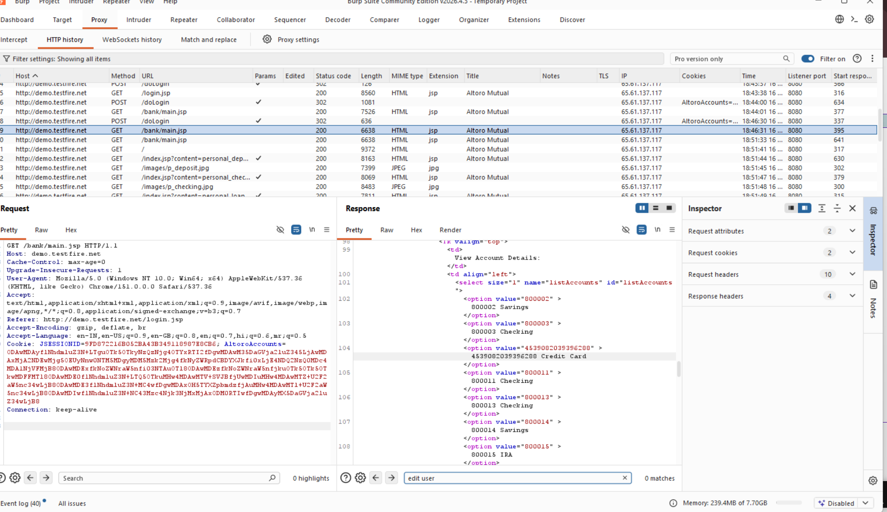
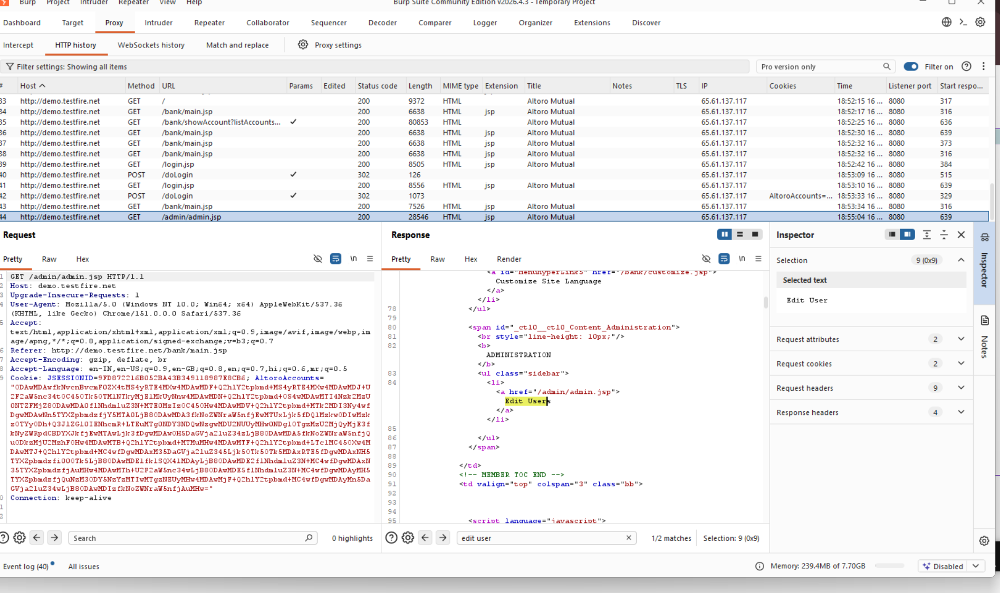
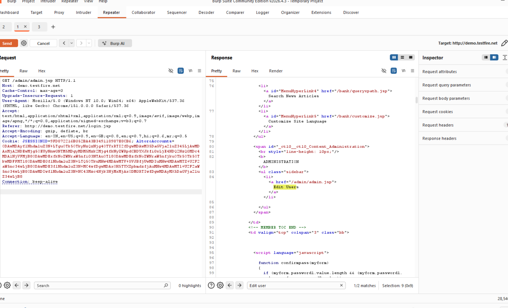
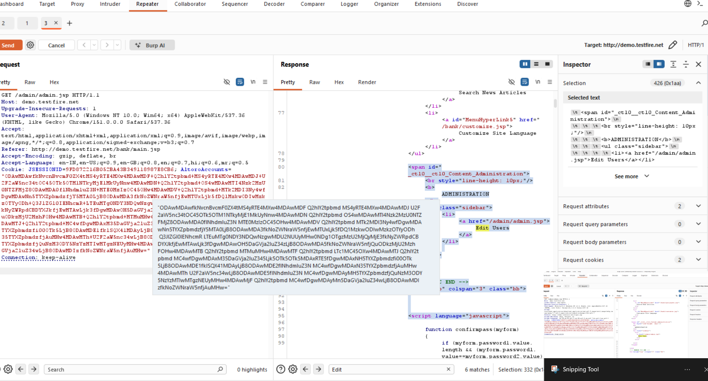

# Finding 01 — Admin Panel Accessible Without Authorization

| Field | Detail |
|---|---|
| **Severity** | 🔴 Critical |
| **Affected URL** | `http://demo.testfire.net/admin/admin.jsp` |
| **OWASP Category** | A01:2021 – Broken Access Control |

---

## Description & Impact

The administrative panel at `/admin/admin.jsp` is directly accessible to any unauthenticated visitor — no login, no role check, no challenge of any kind. An attacker who navigates to this URL gains full administrative functionality of the banking application, including the ability to add users, view all accounts, and perform privileged operations. This is a complete authentication bypass on the most sensitive part of the application.

---

## Steps to Reproduce

1. Open a browser (do **not** log in).
2. Navigate directly to `http://demo.testfire.net/admin/admin.jsp`.
3. **Result:** The admin panel loads and presents administrative controls without any authentication prompt.

---

## Screenshots

---

## Remediation

- Enforce server-side authentication on every request to `/admin/*` — reject unauthenticated requests with HTTP 401/403 before any business logic runs.
- Add role-based access control so only accounts with an explicit `ADMIN` role can reach admin endpoints.
- Do not rely on URL obscurity; assume any endpoint path can be guessed or found via directory traversal (see Finding 10).
