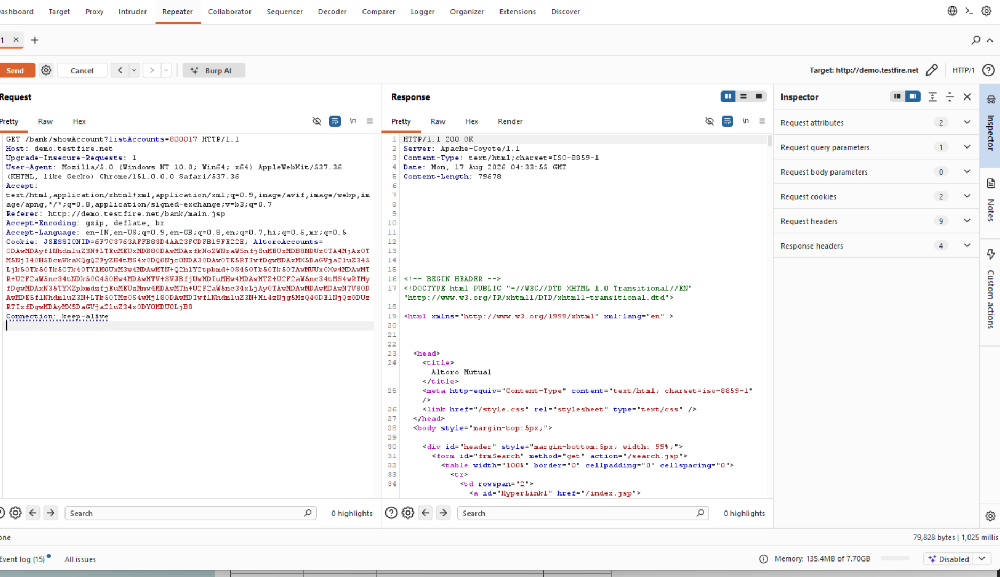
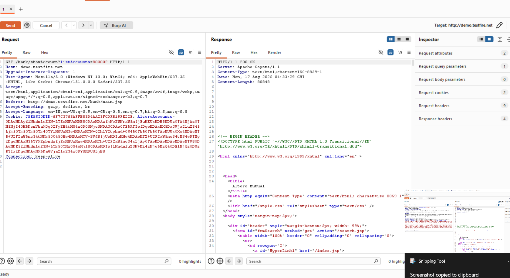

# Finding 03 — IDOR: Unauthorized Access to Other Users' Bank Accounts

| Field | Detail |
|---|---|
| **Severity** | 🔴 Critical |
| **Affected URL** | `http://demo.testfire.net/bank/showAccount?listAccounts=<account_number>` |
| **OWASP Category** | A01:2021 – Broken Access Control (IDOR) |

---

## Description & Impact

The `/bank/showAccount` endpoint accepts an account number via the `listAccounts` GET parameter and returns full account details (balance, transaction history) for that account — with **no check that the account belongs to the currently authenticated user**. Any logged-in user can enumerate account numbers and access any other customer's financial data by simply modifying the parameter value.

This is a classic **Insecure Direct Object Reference (IDOR)**. Combined with the account numbers visible in the `AltoroAccounts` cookie (see Finding 08) and the list returned in the Transfer Funds dropdown, an attacker has multiple ways to harvest valid account numbers to target.

---

## Steps to Reproduce

1. Log in as a normal user (e.g. `jsmith` / `demo1234`).
2. Navigate to the View Account page; note your own account number in the URL or dropdown.
3. In the browser address bar or Burp Repeater, change the `listAccounts` value to a different account number (e.g. `800011`, `800013`, `4539082039396288`).
4. **Result:** The server returns `200 OK` with the full account statement (balance, transactions) for the target account — belonging to a different customer.

---

## Screenshots

---

## Remediation

- On **every** request to `/bank/showAccount`, verify server-side that the `listAccounts` value belongs to the currently authenticated session's user — reject with 403 if not.
- Never derive authorization from client-supplied parameters alone; maintain a server-side mapping of user → owned accounts and enforce it at the data layer.
- Treat account numbers as internal identifiers: do not expose them in cookies, dropdowns, or URLs where they can be harvested (see Finding 08).
