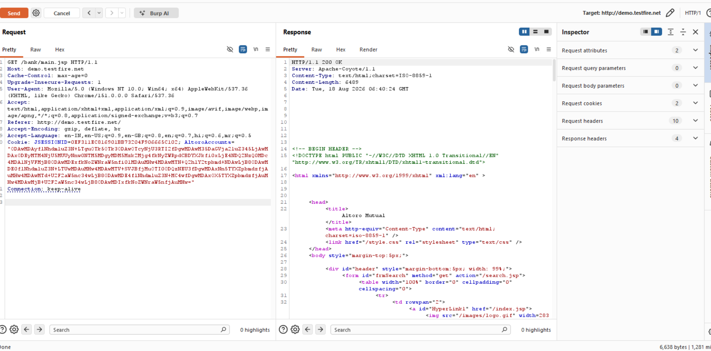
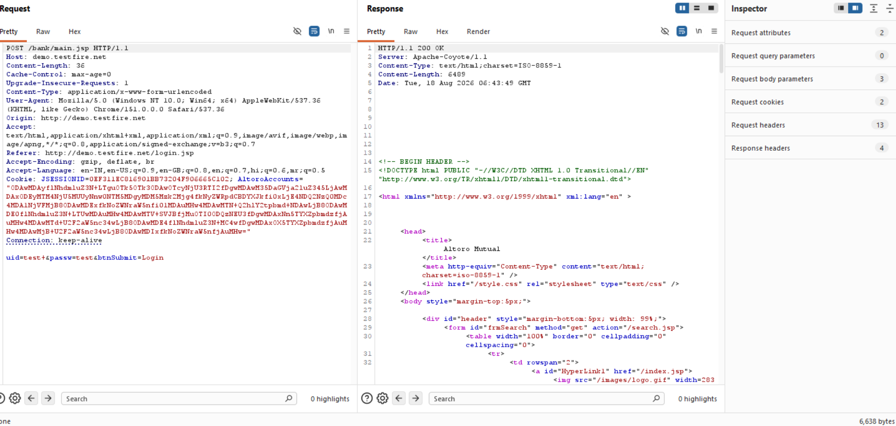

# Finding 05 — Session Fixation

| Field | Detail |
|---|---|
| **Severity** | 🟠 High |
| **Affected URL** | `http://demo.testfire.net/login.jsp` |
| **OWASP Category** | A07:2021 – Identification and Authentication Failures |

---

## Description & Impact

The application issues a session identifier (`JSESSIONID`) to visitors **before** they authenticate, and does **not** regenerate that identifier upon successful login. This enables a **session fixation** attack: if an attacker can plant a known `JSESSIONID` value into a victim's browser (e.g. via a crafted link, XSS, or network interception), the attacker already knows the session ID that will become the victim's authenticated session after login — allowing full session hijacking without ever learning the victim's password.

**Confirmed:** The `JSESSIONID` value captured in browser DevTools before login (`2EC251EC24DD6B191FCC1D7DC3CF1C6F`) is identical to the value observed after successful login.

---

## Steps to Reproduce

1. Open `http://demo.testfire.net/login.jsp` **without** logging in.
2. Open DevTools → **Application** → **Cookies** → note the `JSESSIONID` value.
3. Log in with valid credentials (`jsmith` / `demo1234`).
4. After login redirect, check the `JSESSIONID` cookie again.
5. **Result:** The `JSESSIONID` value is **identical** before and after login — confirmed in the two screenshots below.

---

## Screenshots

---

## Remediation

- **Regenerate the session ID immediately after a successful authentication event.** Invalidate the pre-login session and issue a brand-new `JSESSIONID` on the authenticated response.
- This is standard behavior in modern frameworks (Spring Security, Java EE, etc.) — ensure it is not disabled.
- Also set `HttpOnly`, `Secure`, and `SameSite=Strict` on the session cookie (see Finding 14 for missing flags).
