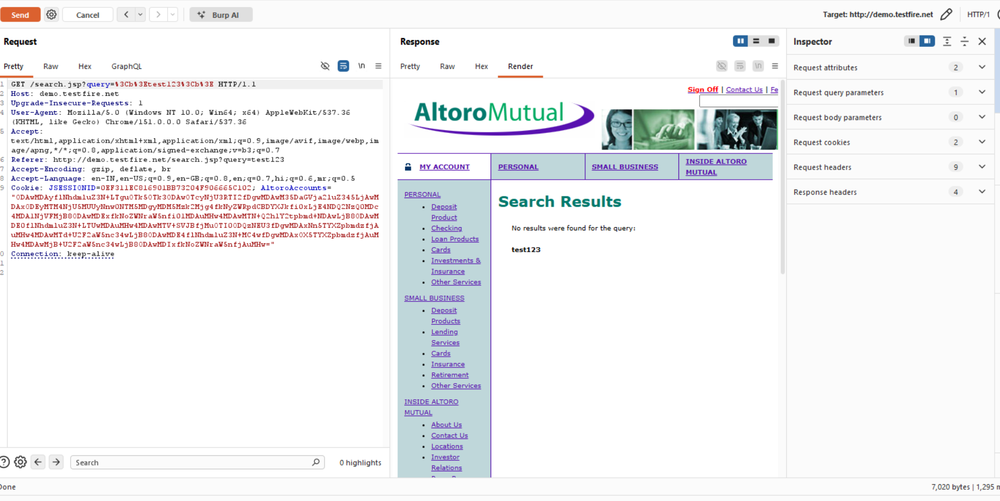
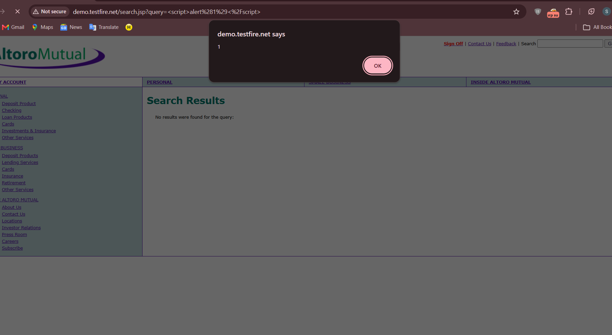
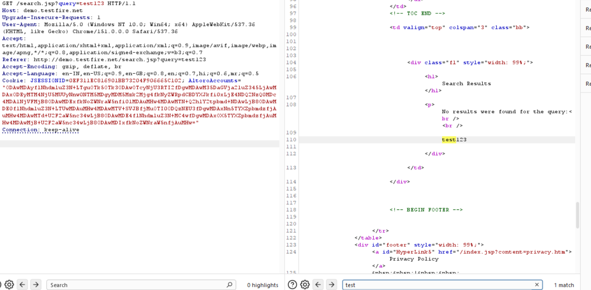
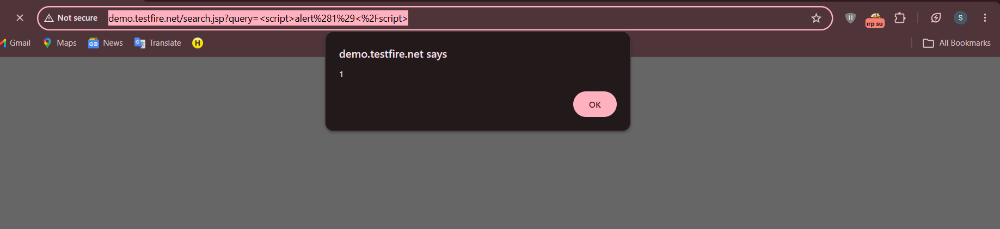

# Finding 06 — Reflected XSS: Search Box and URL Parameter

| Field | Detail |
|---|---|
| **Severity** | 🟠 High |
| **Affected URL** | `http://demo.testfire.net/search.jsp` |
| **OWASP Category** | A03:2021 – Injection (XSS) |

---

## Description & Impact

The search functionality reflects user input back into the page HTML **without any output encoding**. Two distinct vectors confirm the same root cause:

**Vector A — Form Input (Search Box):** A script payload submitted through the search form is rendered unencoded in the results page, executing in the victim's browser.

**Vector B — URL Parameter (`query=`):** The `query` GET parameter is reflected directly into the page, so a crafted URL alone (no user interaction beyond clicking a link) triggers script execution. This is the most dangerous delivery mechanism because the entire payload lives in a shareable link.

An attacker can exploit these to steal session cookies, redirect victims, perform keylogging, or deliver phishing content — all in the context of the legitimate banking domain.

---

## Steps to Reproduce

### Vector A — Search Box
1. Go to `http://demo.testfire.net/search.jsp`.
2. In the search box enter: ``
3. Click **Search**.
4. **Result:** The injected script executes — a JavaScript alert box fires.

### Vector B — URL Parameter
1. Navigate directly to:
   `http://demo.testfire.net/search.jsp?query=`
2. **Result:** A JavaScript alert fires immediately on page load — no form interaction required.

---

## Screenshots

**Vector A — Search box**

**Vector B — URL parameter**

---

## Remediation

- **HTML-encode all user-supplied output** before inserting it into an HTML context — specifically, encode `<`, `>`, `"`, `'`, and `&` as their HTML entities. This is the primary fix.
- Implement a **Content-Security-Policy (CSP)** header that disallows inline scripts (`script-src 'self'`) as defense-in-depth.
- Validate and sanitize the `query` parameter server-side (allow-list of safe characters for a search term).
- See also Finding 17 (Missing Security Headers) for the broader CSP gap.
