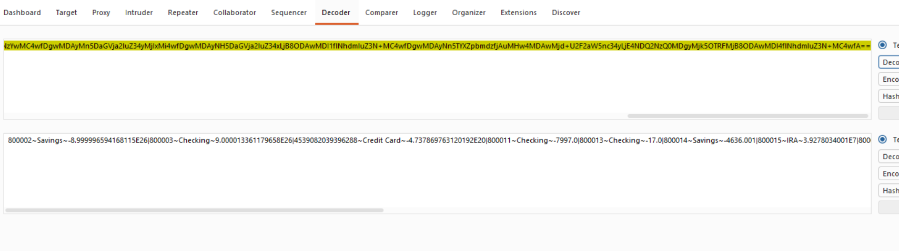

# Finding 08 — Sensitive Account Data Stored Unencrypted in Client-Side Cookie

| Field | Detail |
|---|---|
| **Severity** | 🟠 High |
| **Affected URL** | `http://demo.testfire.net/` (`AltoroAccounts` cookie) |
| **OWASP Category** | A02:2021 – Cryptographic Failures |

---

## Description & Impact

After login, the application sets an `AltoroAccounts` cookie containing a Base64-encoded string. Decoding it reveals **plaintext account numbers, account types, and balances** for the authenticated user — for example:

```
800002~Savings~-8.99...|800003~Checking~...|4539082039396288~Credit Card~...
```

Base64 is **encoding, not encryption** — it is trivially reversible by anyone who can read the cookie. This exposes sensitive financial data on the client side, where it can be:

- **Read** by any JavaScript on the page (no `HttpOnly` guard on this cookie).
- **Tampered with** to alter account references used in subsequent requests, facilitating IDOR (see Finding 03) and parameter-tampering attacks (see Finding 04).
- **Stolen** via XSS (see Findings 06–07), leaking account and balance information along with the session.

---

## Steps to Reproduce

1. Log in to `http://demo.testfire.net/`.
2. Open DevTools → **Application** → **Cookies**.
3. Copy the value of the `AltoroAccounts` cookie.
4. Base64-decode it (DevTools console: `atob('<value>')` or any online decoder).
5. **Result:** The decoded value reveals plaintext account numbers, types, and balances in a pipe-delimited format.

---

## Screenshots



---

## Remediation

- **Do not store sensitive account or balance data in client-side cookies at all.** Keep this state server-side, keyed to the authenticated session.
- If any client-side token is needed, store only a non-sensitive reference (e.g. a server-side session key) — never raw account numbers or balances.
- If client-side storage is truly required for performance, **encrypt** the value with a server-managed key (not just Base64) and validate integrity on each request.
- Set `HttpOnly` on all cookies containing sensitive references to prevent JavaScript access.
