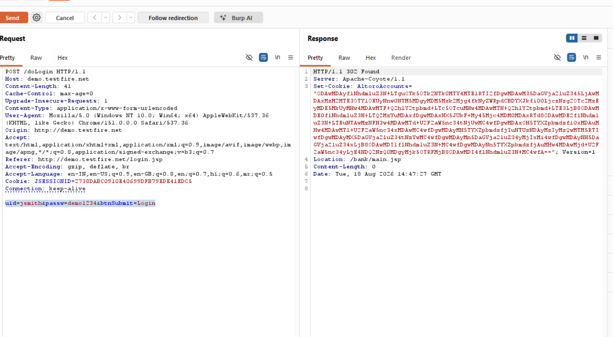

# Finding 09 — Login Credentials Sent Over Unencrypted HTTP

| Field | Detail |
|---|---|
| **Severity** | 🟠 High |
| **Affected URL** | `http://demo.testfire.net/login.jsp` |
| **OWASP Category** | A02:2021 – Cryptographic Failures |

---

## Description & Impact

The entire application — including the login page and authentication POST — is served over plain **HTTP** with no TLS/SSL. Login credentials (`uid`, `passw`) are transmitted in cleartext in the POST body. Anyone with the ability to observe network traffic (on the same Wi-Fi network, via ARP spoofing, a rogue access point, or a network tap) can **capture usernames and passwords in plaintext** without any decryption.

For a banking application, transmitting credentials and session tokens over HTTP represents a fundamental cryptographic failure. Session cookies are also transmitted in cleartext, making session hijacking trivially possible alongside credential theft.

---

## Steps to Reproduce

1. Configure Burp Suite to intercept traffic on `http://demo.testfire.net`.
2. Submit the login form with any credentials.
3. In Burp Proxy → HTTP History, inspect the intercepted POST request to `/doLogin`.
4. **Result:** The `uid` and `passw` values are visible in plain text in the request body — no TLS in use, no HTTPS, `Upgrade-Insecure-Requests: 1` header present but ignored by the server.

---

## Screenshots

---

## Remediation

- **Migrate the entire application to HTTPS** with a valid TLS certificate. HTTP should redirect (301) to HTTPS — never serve the login page or any authenticated page over plain HTTP.
- Once on HTTPS, add the `Strict-Transport-Security` (HSTS) header to prevent protocol downgrade attacks. See Finding 22.
- Mark all session cookies with the `Secure` flag so they are never transmitted over HTTP. See Finding 14.
