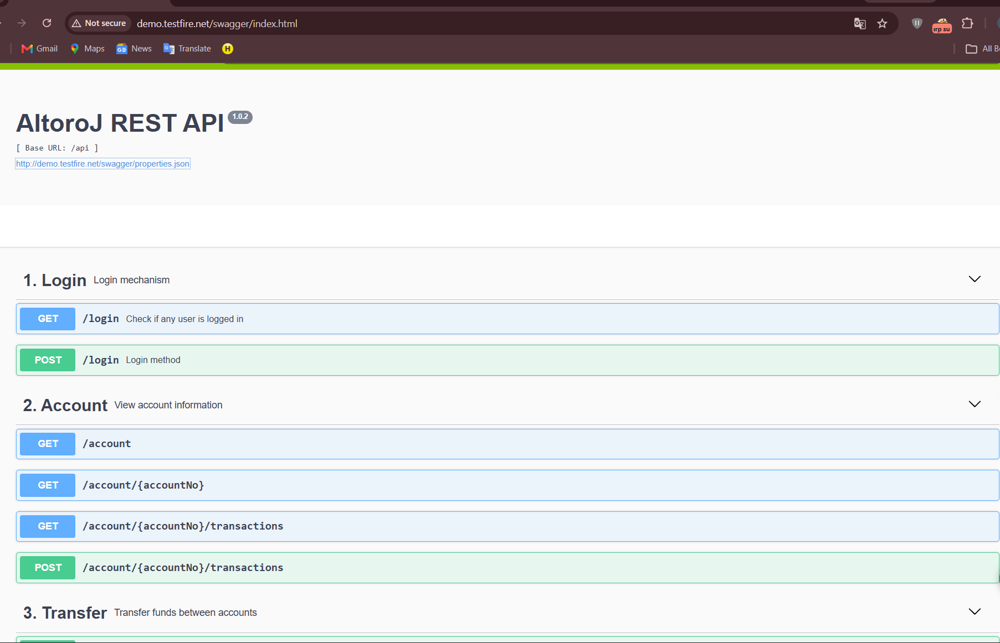
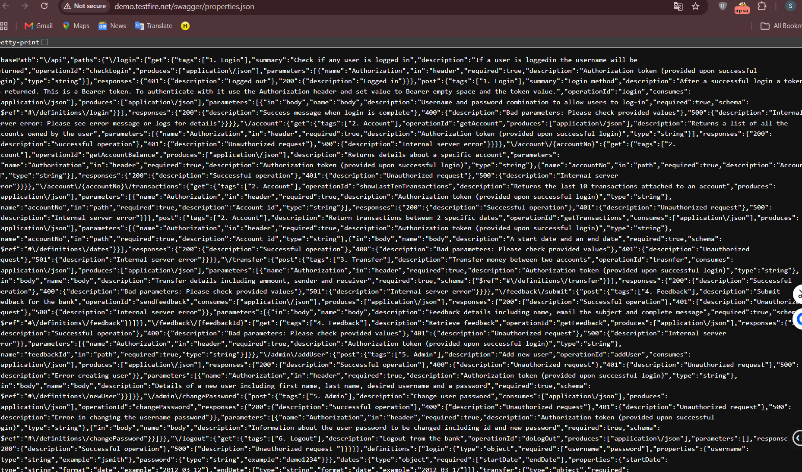

# Finding 11 — Swagger UI and API Schema Publicly Exposed

| Field | Detail |
|---|---|
| **Severity** | 🟡 Medium |
| **Affected URLs** | `http://demo.testfire.net/swagger/index.html` · `http://demo.testfire.net/swagger/properties.json` |
| **OWASP Category** | A05:2021 – Security Misconfiguration |

---

## Description & Impact

Two Swagger/OpenAPI resources are publicly accessible without any authentication:

**Vector A — Swagger UI (`/swagger/index.html`):** The interactive API documentation interface for the "AltoroJ REST API" loads with no login required. It lists every REST endpoint (login, account management, transactions, etc.) along with their HTTP methods, parameter names, and expected formats — providing an attacker with a ready-made, structured map of the application's entire attack surface.

**Vector B — API Schema File (`/swagger/properties.json`):** The raw OpenAPI/JSON schema definition file is directly downloadable without authentication, exposing the underlying API structure in machine-readable form — ideal for automated scanning or fuzzing.

Together these reduce an attacker's reconnaissance effort from hours to minutes.

---

## Steps to Reproduce

### Vector A — Swagger UI
1. Open a browser **without logging in**.
2. Navigate to `http://demo.testfire.net/swagger/index.html`.
3. **Result:** The full Swagger UI renders, listing all API endpoints and operations.

### Vector B — Schema File
1. Navigate to `http://demo.testfire.net/swagger/properties.json` without authentication.
2. **Result:** The raw JSON API schema is returned directly.

---

## Screenshots

---

## Remediation

- **Remove Swagger UI and schema files entirely from the production environment.** API documentation belongs in internal developer environments only.
- If Swagger must be accessible, protect it behind authentication and restrict access to internal IP ranges.
- Review the `/swagger/` path in the web server configuration and explicitly deny public access (e.g. a 403 rule at the reverse proxy level).
