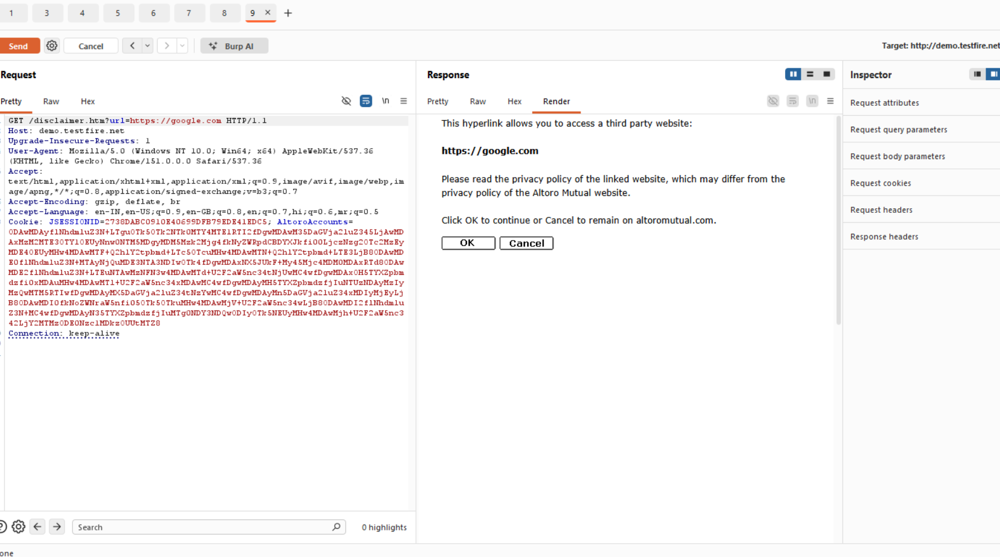

# Finding 12 — Open Redirect via disclaimer.htm

| Field | Detail |
|---|---|
| **Severity** | 🟡 Medium |
| **Affected URL** | `http://demo.testfire.net/disclaimer.htm?url=<destination>` |
| **OWASP Category** | A01:2021 – Broken Access Control |

---

## Description & Impact

The disclaimer page accepts a `url` GET parameter and redirects (or presents a "click to continue" link) to the supplied destination **without validating that it is an internal or trusted address**. An attacker can craft a URL that appears to originate from the legitimate bank domain but sends victims to any external site:

```
http://demo.testfire.net/disclaimer.htm?url=https://attacker.com/fake-login
```

This is a classic **open redirect**, commonly used in phishing campaigns: the link passes email filters and user suspicion checks because the domain shown is the real bank's domain, but the victim ends up on an attacker-controlled page.

---

## Steps to Reproduce

1. Without logging in, navigate to:
   `http://demo.testfire.net/disclaimer.htm?url=https://www.google.com`
2. **Result:** The disclaimer page loads and presents a link/redirect to `https://www.google.com` — an external site — without any validation that the destination is trusted or internal.

---

## Screenshots



---

## Remediation

- **Validate the `url` parameter against an allow-list** of trusted internal destinations. If the value does not match, reject or redirect to a safe default.
- Prefer using **fixed internal link identifiers** (e.g. `?dest=account` maps server-side to `/bank/main.jsp`) rather than accepting raw URLs from the client.
- If external links are genuinely needed, display the destination URL explicitly and require a user confirmation step — do not auto-redirect to arbitrary external addresses.
