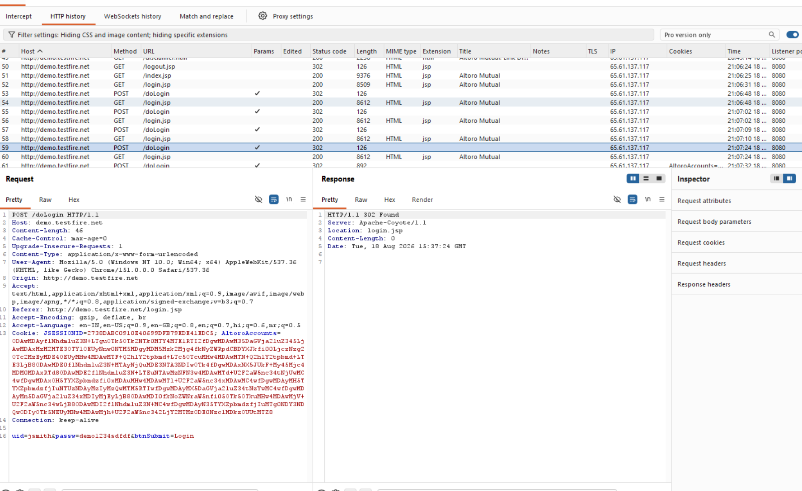

# Finding 13 — No Account Lockout Policy

| Field | Detail |
|---|---|
| **Severity** | 🟡 Medium |
| **Affected URL** | `http://demo.testfire.net/login.jsp` (POST to `/doLogin`) |
| **OWASP Category** | A07:2021 – Identification and Authentication Failures |

---

## Description & Impact

The `/doLogin` endpoint does not implement any rate limiting, account lockout, or throttling mechanism after repeated failed login attempts. An attacker can submit unlimited credential guesses against any account without consequence — making **online brute-force and password-spray attacks** fully practical.

Burp Suite Intruder (or any script sending repeated POSTs) can automate this. Combined with the absence of HTTPS (Finding 09) and no CAPTCHA, the authentication layer provides minimal resistance to automated attacks.

---

## Steps to Reproduce

1. Go to `http://demo.testfire.net/login.jsp`.
2. Enter a valid username (e.g. `jsmith`) with an **incorrect** password.
3. Submit. Repeat 10 or more times in rapid succession.
4. Attempt an 11th, 20th, and 30th login with the same incorrect credentials.
5. **Result:** Every request returns `HTTP 302 Found` → redirect back to `login.jsp`. No lockout message, no delay, no CAPTCHA, no blocking — confirmed in the Burp HTTP history showing consecutive `/doLogin` POSTs all returning 302.

---

## Screenshots

---

## Remediation

- Implement **account lockout** (e.g. lock after 5–10 failed attempts for 15–30 minutes) or **exponential back-off** (increasing delays between allowed attempts).
- Add **CAPTCHA** after 3–5 failed attempts to block automated guessing.
- Implement **login attempt monitoring and alerting** — flag and investigate accounts with high failure rates.
- Consider **IP-based rate limiting** at the WAF or reverse proxy level as a complementary layer.
