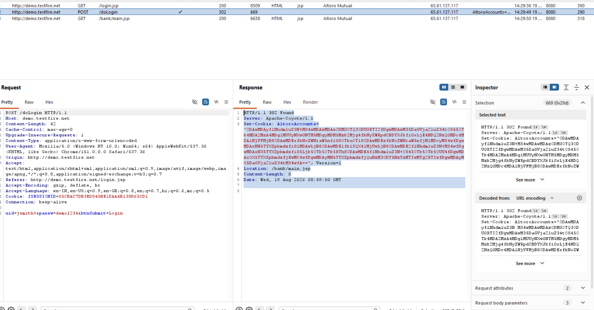

# Finding 14 — Missing Cookie Security Flags

| Field | Detail |
|---|---|
| **Severity** | 🟡 Medium |
| **Affected URL** | `http://demo.testfire.net/` (`JSESSIONID` session cookie) |
| **OWASP Category** | A05:2021 – Security Misconfiguration |

---

## Description & Impact

The `JSESSIONID` session cookie is missing two critical security attributes:

| Flag | Status | Risk if missing |
|---|---|---|
| `HttpOnly` | ✅ Present | — |
| `Secure` | ❌ **Missing** | Cookie sent over plain HTTP; interceptable in cleartext (see Finding 09) |
| `SameSite` | ❌ **Missing** | Browser sends cookie on cross-origin requests, enabling CSRF (see Finding 18) |

Without `Secure`, the session token can be captured alongside credentials over plain HTTP. Without `SameSite`, cross-site request forgery becomes easier because the browser will automatically attach the cookie to requests initiated from third-party pages.

---

## Steps to Reproduce

1. Log in to `http://demo.testfire.net/`.
2. Open DevTools → **Application** → **Cookies** → `demo.testfire.net`.
3. Inspect the `JSESSIONID` entry.
4. **Result:** `HttpOnly` is checked, but **`Secure` and `SameSite` columns are blank/unchecked** — confirmed in the screenshot.

---

## Screenshots

---

## Remediation

- Set the **`Secure`** flag on `JSESSIONID` and all session cookies — this prevents transmission over HTTP.
- Set **`SameSite=Strict`** (or `Lax` minimum) to block cross-site cookie submission.
- These flags are only effective once the site is served over HTTPS (see Finding 09). The `Secure` flag requires HTTPS to function.
- Review all cookies set by the application (including `AltoroAccounts` — see Finding 08) and apply appropriate flags.
