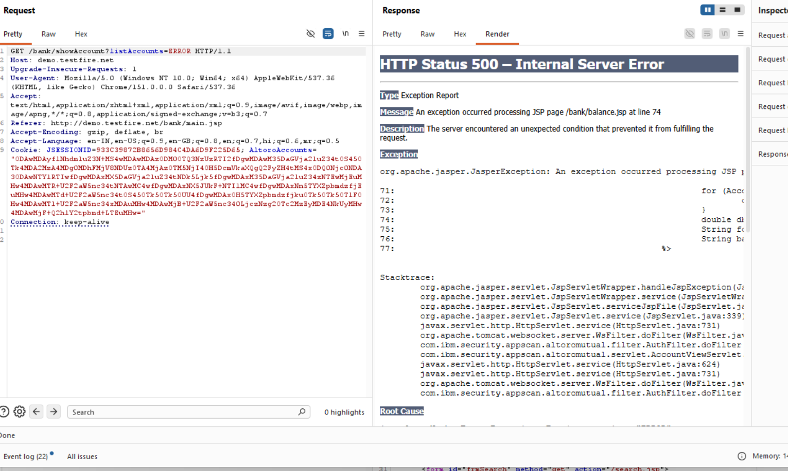

# Finding 15 — Verbose Error Messages / Stack Trace Disclosure

| Field | Detail |
|---|---|
| **Severity** | 🟡 Medium |
| **Affected URL** | `http://demo.testfire.net/bank/showAccount?listAccounts=ERROR` |
| **OWASP Category** | A05:2021 – Security Misconfiguration |

---

## Description & Impact

Submitting an invalid value for the `listAccounts` parameter triggers an unhandled server exception that returns a **full Java stack trace** in the browser response. The disclosed information includes:

- Internal Java class names: `com.ibm.security.appscan.altoromutual.*`
- Full servlet call chain and method names
- Exact application server version: **Apache Tomcat/7.0.92**

This is high-value reconnaissance. An attacker learns the exact framework, version, and internal code structure — Tomcat 7.0.92 is an old, end-of-life release with numerous publicly documented CVEs. The stack trace also confirms the injection points found in Finding 02 (SQL injection errors reveal the same pattern).

---

## Steps to Reproduce

1. Log in to the application.
2. Navigate to:
   `http://demo.testfire.net/bank/showAccount?listAccounts=ERROR`
   (or any non-numeric / invalid value for `listAccounts`)
3. **Result:** The server returns a detailed error page showing the full Java stack trace, internal class/package names, and the Tomcat version string — instead of a generic error page.

---

## Screenshots

---

## Remediation

- **Disable detailed error output in production.** Configure the application server and framework to return a generic, user-friendly error page (e.g. "Something went wrong — please try again") for all unhandled exceptions.
- **Log full exception details server-side only** (to a log file or SIEM) — never include them in the HTTP response body.
- Suppress or customize the `Server` response header to remove the Tomcat version string (see also Finding 24).
- Upgrade Apache Tomcat from 7.0.92 (end-of-life) to a current, supported release.
